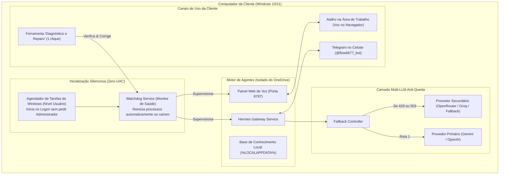

# Plano Arquitetural de Melhorias · Flow Automation

Este documento detalha o plano de modernização, resiliência e empacotamento comercial do **Time de Agentes de IA da Flow Automation**, transformando a aplicação em uma solução enterprise, estável e pronta para ser vendida e instalada em clientes.

---

## 1. Raio-X da Arquitetura e Diagnóstico dos Problemas

Durante a execução dos testes práticos em segundo plano, identificamos 4 vulnerabilidades estruturais:

| Ponto de Falha | Severidade | Causa Raiz | Impacto no Cliente |
| :--- | :---: | :--- | :--- |
| **Queda por Cota de IA (Erro 429 / 503)** | **P0** (Crítico) | Falta de fallback automático quando o provedor primário esgota créditos ou sofre alta demanda. | O Frank para de responder no meio de uma tarefa ou o relatório matinal das 08h falha em silêncio. |
| **Dependência de Terminal e UAC** | **P0** (Crítico) | O gateway depende de terminal aberto ou de permissões de administrador (UAC). | Se a cliente reiniciar o computador ou fechar o PowerShell, o bot do Telegram para de funcionar. |
| **Concorrência com OneDrive** | **P1** (Alto) | Banco SQLite e arquivos Markdown ativos dentro de pastas sincronizadas pela nuvem. | Conflitos de arquivo (`conflicted copy`), travamentos de lock e perda de memória do agente. |
| **Instalação Manual / Não White-Label** | **P1** (Alto) | Dependência de links de cursos e processos manuais com múltiplos comandos de linha. | Dificuldade de entrega técnica e perda da identidade de marca da Flow Automation. |

---

## 2. Arquitetura Alvo Recomendada (Enterprise Ready)

---

## 3. Plano de Implementação em 4 Fases

### 🚀 Fase 1: Inicialização Silenciosa no Windows (Sem Administrador) + Watchdog
* **O que faz**: Cria uma Tarefa Agendada no Windows no escopo do usuário corrente (`schtasks /Create ... /SC ONLOGON`). Não abre janela preta, não pede senha de administrador (UAC) e inicia junto com o Windows.
* **Watchdog de Integridade**: Um script leve roda a cada 60s em background. Se a cliente fechar o painel de voz ou o gateway cair por instabilidade de rede, ele reinicia o serviço silenciosamente e registra no log.

### 🛡️ Fase 2: Resiliência Multi-LLM (Fallback Automático contra Quotas)
* **O que faz**: Configura o motor de IA com uma lista de provedores ordenados por prioridade.
* **Comportamento**:
  1. O Frank tenta primeiro a rota primária (ex: Gemini Flash).
  2. Se a API retornar `429 (Resource Exhausted)` ou `503 (High Demand)`, o motor redireciona a requisição instantaneamente para a rota secundária (ex: OpenAI ou modelo alternativo).
  3. O Frank envia um aviso amigável no Telegram: *"Dono, notei uma oscilação momentânea na API primária e concluí sua tarefa usando o motor reserva."*

### 💼 Fase 3: Pacote Comercial White-Label (Instalação em 2 Cliques)
* **O que faz**: Desvincula a aplicação de qualquer referência a cursos externos e cria a identidade oficial da **Flow Automation**.
* **Entregáveis**:
  1. `Instalar-Flow-Automation.bat`: A cliente ou você dá dois cliques, uma interface amigável abre, solicita os dados do negócio e instala tudo sozinha.
  2. `configuracao-cliente.json`: Arquivo central onde ficam nome da empresa, produtos, tom de voz e chaves sem precisar mexer em código.
  3. Isolamento completo de diretórios para que o OneDrive não cause conflitos de lock no SQLite.

### 🩺 Fase 4: Utilitário de Diagnóstico e Auto-Cura (Self-Healing)
* **O que faz**: Elimina 95% do suporte técnico pós-venda.
* **Entregáveis**:
  * Um atalho na Área de Trabalho da cliente chamado **`Diagnóstico Flow Automation.bat`**.
  * Ao clicar, faz 6 testes automáticos (Internet, Telegram, Cota de IA, Porta 8787, Permissões de Pasta, Gateway).
  * Se encontrar algo errado, exibe um botão **[Reparar Agora]** que limpa portas presas, reinicia os serviços e restaura a comunicação.

