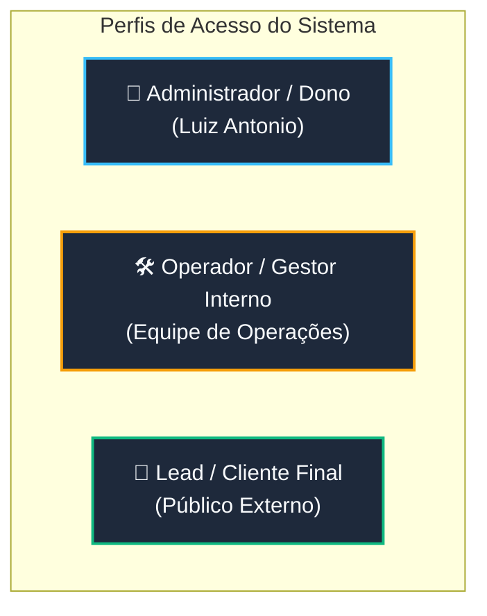

# Documentação Técnica, Operacional e de Processos (BPMN & POP)
## Flow Automation · Plataforma Frank & Time de Agentes Autônomos de IA

---

### Metadados do Sistema
* **Nome do Software:** Flow Automation · Time do Frank (Frank & Time de Agentes Autônomos de I.A.)
* **Versão:** 1.0.0 (Painel v0.3.10 / Hermes Engine Core)
* **Organização Mantenedora:** Flow Automation
* **Arquiteto Líder & Dono:** Luiz Antonio
* **Data da Documentação:** 09/11/2026
* **Classificação:** Documentação Técnica, Operacional e Corporativa (Confidencial / Uso Interno e Clientes)

---

# Módulo 1: Arquitetura e Visão Geral

## 1.1 Resumo Executivo
O **Flow Automation (Time do Frank)** é uma plataforma enterprise de agentes autônomos de inteligência artificial desenhada para resolver o gargalo de sobrecarga operacional, fragmentação de ferramentas e falta de orquestração estratégica em pequenas e médias empresas, infoprodutores e agências digitais.

Tradicionalmente, a adoção de IA em negócios resume-se a chats isolados (ChatGPT, Claude) onde o operador precisa copiar e colar contextos repetidamente, sem memória compartilhada, sem capacidade de delegar tarefas complexas entre especialistas e sem interface natural por voz ou mensageria direta.

O sistema introduz uma **estrutura corporativa sintética liderada pelo Frank (Agente Gestor / Copiloto Executivo)**, que coordena uma equipe de 7 agentes especialistas autônomos (**Renata, Breno, Marina, Lara, Vitor, Ulisses e Isabela**). O usuário interage através de linguagem natural — seja por **voz contínua bidirecional em tempo real (Gemini Live / GPT Live)** em um painel web local, via **mensageria instantânea com áudio (Telegram Bot)**, ou por **linha de comando (CLI)**. Frank interpreta as intenções, consulta a base de conhecimento corporativa (`~/empresa/banco/`), gera e monitora demandas num quadro Kanban dinâmico, aciona os especialistas necessários e submete ações de impacto financeiro ou público à validação do usuário por meio de um protocolo **Human-in-the-Loop (HITL)**.

---

## 1.2 Arquitetura do Sistema

```
┌─────────────────────────────────────────────────────────────────────────────┐
│                            CAMADA DE INTERFACE                              │
│  ┌────────────────────────┐  ┌───────────────────────┐  ┌────────────────┐  │
│  │ Painel Web de Voz      │  │ Telegram Bot          │  │ CLI Unificada  │  │
│  │ (Web Audio / PCM 24kHz)│  │ (@flow6677_bot)       │  │ (flow-cli.mjs) │  │
│  └───────────┬────────────┘  └───────────┬───────────┘  └───────┬────────┘  │
└──────────────┼───────────────────────────┼──────────────────────┼───────────┘
               │                           │                      │
┌──────────────▼───────────────────────────▼──────────────────────▼───────────┐
│                     CAMADA DE SERVIÇOS & SERVIDOR WEB                       │
│  Node.js 22+ (server.mjs / functions/api/)                                  │
│  ├── Proxy WebSocket & Gemini Live / GPT-4o Realtime                        │
│  ├── Gerenciamento de Demandas & Server-Sent Events (SSE)                   │
│  ├── API REST de Agentes e Kanban (/api/frank/agentes, /api/frank/demandas) │
│  └── Cofre Criptográfico Centralizado (_lib/cofre.js - AES-256-GCM)         │
└──────────────────────────────────────┬──────────────────────────────────────┘
                                       │
┌──────────────────────────────────────▼──────────────────────────────────────┐
│                    MOTOR DE ORQUESTRAÇÃO DE AGENTES (HERMES)                │
│  Hermes Agent CLI & Gateway Subsystem                                        │
│  ┌───────────────────────────────────────────────────────────────────────┐  │
│  │ Frank (Gestor Geral) ──────────────────────────┐                      │  │
│  │ ├── Orquestração, Triagem e Planejamento      │                      │  │
│  │ └── Protocolo de Autorização HITL             │                      │  │
│  └───────────────────────────────────┬───────────────────────────────────┘  │
│                                      │ Delegação & Monitoramento            │
│  ┌───────────────────────────────────▼───────────────────────────────────┐  │
│  │ Agentes Especialistas:                                                │  │
│  │ • Renata (Copywriter)       • Breno (Tráfego Pago)                    │  │
│  │ • Marina (Páginas/Web)      • Lara (Reels/Redes Sociais)              │  │
│  │ • Vitor (Atendimento/SDR)   • Ulisses (Estrategista de Negócios)      │  │
│  │ • Isabela (Resultados/BI)                                             │  │
│  └───────────────────────────────────────────────────────────────────────┘  │
└──────────────────────────────────────┬──────────────────────────────────────┘
                                       │
┌──────────────────────────────────────▼──────────────────────────────────────┐
│                    DADOS, PERSISTÊNCIA & CONHECIMENTO                       │
│  ┌────────────────────────┐  ┌──────────────────────┐  ┌─────────────────┐  │
│  │ SQLite Nativo (Node 22)│  │ Base de Conhecimento │  │ Cofre Seguro    │  │
│  │ Schema versionado      │  │ Compartilhada        │  │ Chaves de API & │  │
│  │ Migrations & ORM       │  │ ~/empresa/banco/*.md │  │ Tokens (.enc)   │  │
│  └────────────────────────┘  └──────────────────────┘  └─────────────────┘  │
└─────────────────────────────────────────────────────────────────────────────┘
```

### Detalhamento dos Componentes Tecnológicos

| Componente | Tecnologia Adotada | Finalidade Técnica |
| :--- | :--- | :--- |
| **Ambiente de Execução** | Node.js v22+ (ES Modules) | Runtime unificado para o servidor web, proxy WebSocket de áudio e scripts operacionais. |
| **Orquestrador de Agentes** | Hermes Agent Core | Framework autônomo baseado no Nous Hermes com injeção de `SOUL.md`, habilidades (`skills`) e ferramentas de sistema. |
| **Live Voice & Streaming** | Google Gemini Live API / OpenAI Realtime | Protocolo WebSocket bidirecional para streaming contínuo de áudio PCM 16-bit 24kHz com baixa latência e interrupção fluida. |
| **Banco de Dados Relacional** | SQLite nativo (`node:sqlite`) | Armazenamento de perfil dinâmico de agentes, auditoria, estado de demandas e histórico de execuções com migrações versionadas. |
| **Cofre de Segredos** | AES-256-GCM + PBKDF2 (100.000 rounds) | Armazenamento criptografado de credenciais (`GEMINI_API_KEY`, `OPENAI_API_KEY`, `TELEGRAM_BOT_TOKEN`) com injeção segura apenas em tempo de execução. |
| **Mensageria Assíncrona** | Telegram Bot API (`@flow6677_bot`) | Canal móvel para envio de demandas em texto e áudio pelo smartphone do usuário executivo. |
| **Base de Conhecimento** | Markdown Estruturado (`~/empresa/banco/`) | Arquivos padronizados (`empresa.md`, `ofertas.md`, `avatar.md`, `tom-de-voz.md`, etc.) indexados diretamente no contexto dos agentes. |
| **Alta Disponibilidade** | Windows Watchdog (`flow-watchdog.ps1`) / Docker | Monitoramento contínuo com auto-recuperação (restarts automáticos em caso de falha de serviço ou reinicialização do sistema operacional). |

---

# Módulo 2: Mapeamento de Usuários e Jornada

## 2.1 Personas e Perfis de Acesso



### Matriz de Responsabilidades e Acessos (RACI)

| Funcionalidade / Recurso | Administrador (Dono) | Operador Interno | Lead / Cliente Final |
| :--- | :---: | :---: | :---: |
| **Acesso ao Painel de Voz Web (Local)** | Total (R/W/Config) | Operacional (R/W) | Proibido |
| **Canal Telegram Executivo (`@flow6677_bot`)** | Total (Autorizado) | Mediante Permissão | Proibido |
| **Aprovação HITL (Ações Críticas / Finanças / Ads)** | Exclusivo (Aprovador) | Somente Consulta | Proibido |
| **Edição da Base de Conhecimento (`empresa/banco`)** | Total | Colaborativo | Proibido |
| **Gerenciamento do Cofre de Chaves e Migrações** | Exclusivo | Proibido | Proibido |
| **Interação com Agente de Atendimento (Vitor)** | Auditoria Total | Monitoramento | Interação Direta |

---

## 2.2 Jornada do Usuário (End-to-End)

A jornada principal consiste no ciclo de **Planejamento, Delegação, Execução e Entrega Estratégica**:

```
[Início] Dono acorda e envia áudio no Telegram ou abre o Painel Web de Voz
   │
   ├─► Frank recebe o comando: "Frank, vamos lançar o novo produto X semana que vem!"
   │
   ├─► Frank consulta a Base de Conhecimento (`empresa/banco/ofertas.md` e `avatar.md`)
   │
   ├─► Frank cria a demanda no Quadro Kanban e aciona o time:
   │     ├─► Renata: Redige a carta de vendas e anúncios (Copywriting)
   │     ├─► Marina: Estrutura a Landing Page de conversão
   │     └─► Breno: Monta a estrutura da campanha de tráfego pago
   │
   ├─► Os especialistas concluem as etapas e reportam ao Frank
   │
   ├─► Frank consolida o plano e aciona o protocolo HITL:
   │     └─► Notifica o Dono: "Luiz, a campanha está pronta com orçamento de R$ 500/dia. Aprova a publicação?"
   │
   ├─► Dono responde "Aprovado" (por voz ou Telegram)
   │
   └─► [Fim de Ciclo] Isabela monitora as métricas e envia o resumo de performance diário
```

---

# Módulo 3: Manual de Uso e Funcionalidades (Como Usar)

## 3.1 Painel de Voz em Tempo Real (Web Audio)

O painel de voz local oferece uma experiência conversacional de baixíssima latência (áudio bidirecional ininterrupto).

### Passo a Passo de Utilização:
1. **Inicialização do Painel:**
   * Dê dois cliques no atalho da Área de Trabalho: `Abrir Frank.cmd`.
   * Alternativamente, abra o navegador e acerte a URL: `http://127.0.0.1:8787`.
2. **Conexão de Áudio:**
   * Clique no botão circular de microfone no centro da tela.
   * O navegador solicitará permissão de microfone: clique em **Permitir**.
   * O indicador de status mudará para `🟢 Conectado (Voz: Puck)`.
3. **Conversação:**
   * Fale naturalmente em português. O Frank ouve continuamente, processa sua intenção e responde por voz sintética.
   * Você pode interromper o Frank a qualquer momento falando por cima (recurso de *barge-in* nativo do Gemini Live).

---

## 3.2 Interação Remota via Telegram Bot

Permite comandar toda a operação a partir do smartphone via mensagens de texto ou notas de voz.

### Passo a Passo de Utilização:
1. Abra o aplicativo do Telegram e localize o bot oficial: `@flow6677_bot`.
2. Pressione `/start` para inicializar a sessão.
3. Para enviar uma demanda:
   * **Por Texto:** Digite a ordem detalhada (ex: *"Frank, peça para a Renata criar 3 opções de gancho para o produto Mentoria Flow"*).
   * **Por Áudio:** Grave uma mensagem de voz no Telegram. O motor transcreve o áudio automaticamente, processa o contexto e responde com o plano de ação.

---

## 3.3 Gestão e Auditoria via CLI Unificada (`flow-cli.mjs`)

Todas as operações de sustentação foram unificadas no script `scripts/flow-cli.mjs`:

```bash
# 1. Executar diagnóstico de saúde de todos os 8 agentes e subsistemas
npm run diagnostico

# 2. Executar diagnóstico com auto-recuperação (corrige pastas e dependências)
node scripts/flow-cli.mjs diagnostico --fix

# 3. Verificar status do Cofre Criptográfico de Segredos
npm run cofre:status

# 4. Inserir ou atualizar credencial com segurança no Cofre
node scripts/flow-cli.mjs cofre set GEMINI_API_KEY "sua-chave-aqui"

# 5. Executar migrações do banco de dados SQLite
npm run db:migrar

# 6. Rodar suíte completa de testes automatizados
npm test
```

---

## 3.4 Regras de Negócio e Políticas do Sistema

| Código | Regra de Negócio | Descrição Operacional |
| :---: | :--- | :--- |
| **RN-01** | **Human-in-the-Loop (HITL)** | Nenhuma ação que envolva gasto financeiro (ex: orçamento de anúncios), exclusão de banco de dados ou envio de e-mails em massa pode ser executada de forma 100% autônoma. O Frank deve obrigatoriamente solicitar confirmação explícita do Dono. |
| **RN-02** | **Isolamento de Escopo dos Agentes** | Cada agente especialista só pode atuar dentro de sua pasta de habilidades (`skills`). Se o Breno receber uma solicitação de copywriting, ele deve delegar a demanda ao Frank para reencaminhamento à Renata. |
| **RN-03** | **Sanitização Estrita de Chaves (Cofre)** | Nenhuma chave de API ou token de mensageria pode ser armazenado em texto puro em arquivos do repositório Git. Logs do servidor devem aplicar a função `mascararChave()` (exibindo apenas os 4 primeiros e 4 últimos dígitos). |
| **RN-04** | **Resiliência Multi-LLM (Fallback)** | Em caso de falha de cota, rate limit (HTTP 429) ou indisponibilidade temporária do provedor principal (Google Gemini), o sistema deve chavear automaticamente para o provedor secundário (OpenAI GPT-4o). |

---

# Módulo 4: Procedimento Operacional Padrão (POP)

---

### POP-01: Inicialização, Monitoramento Diário e Verificação de Integridade (Auto-Cura)

* **Objetivo:** Garantir a prontidão operacional de todos os 8 agentes, serviços de rede e banco de dados no início do expediente diário.
* **Responsável:** Operador de Sistemas / Dono (Luiz Antonio).
* **Materiais / Ferramentas:** Terminal PowerShell ou Atalho da Área de Trabalho, Navegador Google Chrome/Edge, Conexão à Internet.

#### Passos Sequenciais de Execução:
1. **Ligar a Estação de Trabalho:** Ao iniciar o Windows, o script de inicialização `FlowAutomationWatchdog.vbs` é executado automaticamente em segundo plano.
2. **Executar Diagnóstico Rápido:**
   * Abra o PowerShell na pasta do projeto e execute:
     ```powershell
     npm run diagnostico
     ```
   * Verifique se todos os itens apresentam status `[OK]`:
     * Conectividade com a internet e APIs de IA.
     * Integridade dos arquivos de configuração dos 8 agentes (`SOUL.md`).
     * Status do banco de dados SQLite e do cofre criptográfico.
     * Status das portas de rede `8787` (Painel) e `8642` (Hermes API).
3. **Abrir a Interface de Controle:**
   * Dê dois cliques em `Abrir Frank.cmd` na Área de Trabalho.
   * Verifique a mensagem de boas-vindas do Frank no painel web.

#### Ações em Caso de Erro / Exceções:
* **Se o diagnóstico acusar falha em arquivos:** Execute imediatamente o comando de auto-cura:
  ```powershell
  node scripts/flow-cli.mjs diagnostico --fix
  ```
* **Se o painel web não responder em `http://127.0.0.1:8787`:** Mate processos residuais e suba o serviço manualmente:
  ```powershell
  Stop-Process -Name node -Force -ErrorAction SilentlyContinue
  npm start
  ```

---

### POP-02: Execução de Demanda Estratégica com Delegação Multi-Agente e Aprovação HITL

* **Objetivo:** Padronizar a criação, distribuição e validação de uma campanha de marketing completa entre os agentes autônomos.
* **Responsável:** Frank (Orquestrador) sob supervisão do Dono.
* **Materiais / Ferramentas:** Painel de Voz do Frank ou Telegram Bot `@flow6677_bot`.

#### Passos Sequenciais de Execução:
1. **Entrada da Demanda:**
   * O Dono envia o briefing: *"Frank, estruturar campanha de tráfego para a Oferta Black Friday"*.
2. **Triagem e Análise de Contexto (Frank):**
   * Frank lê `~/empresa/banco/ofertas.md` e `~/empresa/banco/avatar.md` para resgatar persona e preços.
   * Frank cria as tarefas no Kanban:
     * Tarefa 1: *Copywriting de 3 anúncios* -> Delegada para **Renata**.
     * Tarefa 2: *Landing Page de Captura* -> Delegada para **Marina**.
     * Tarefa 3: *Planejamento de Campanhas Meta Ads* -> Delegada para **Breno**.
3. **Execução Especializada:**
   * Cada agente executa a sua skill específica de forma assíncrona e grava os entregáveis em `empresa/entregas/`.
4. **Consolidação e Protocolo HITL:**
   * Frank compila os materiais em uma mensagem executiva.
   * Frank envia mensagem ao Dono com a pergunta de confirmação formal:
     > *"Luiz, os criativos e a estrutura de campanha estão prontos. Orçamento recomendado: R$ 150/dia. Deseja aprovar a publicação?"*
5. **Aprovação e Encerramento:**
   * O Dono responde *"Aprovado"*.
   * Frank finaliza a demanda no Kanban e move o card para `Concluído`.

#### Ações em Caso de Erro / Exceções:
* **Se o Dono rejeitar a entrega:** O Frank solicita os pontos de ajuste e devolve a tarefa ao especialista com o feedback anotado no card do Kanban.
* **Se uma API de especialista expirar:** O Frank reporta ao Dono que a etapa falhou e sugere reexecução manual via `flow-cli`.

---

### POP-03: Rotação de Segredos e Gestão Criptográfica do Cofre de Credenciais

* **Objetivo:** Atualizar chaves de API expiradas ou comprometidas garantindo que nunca vazem em texto aberto.
* **Responsável:** Administrador de Segurança / Dono.
* **Materiais / Ferramentas:** Console Node.js nativo, utilitário `flow-cli.mjs`.

#### Passos Sequenciais de Execução:
1. **Identificar a Chave a ser Atualizada:**
   * Exemplo: Nova `GEMINI_API_KEY` gerada no Google AI Studio.
2. **Checar Integridade Atual do Cofre:**
   ```powershell
   npm run cofre:status
   ```
3. **Injetar a Nova Chave Criptografada:**
   * Execute o comando com a nova credencial:
     ```powershell
     node scripts/flow-cli.mjs cofre set GEMINI_API_KEY "NOVA_CHAVE_AQUI"
     ```
   * O script cifra o valor usando **AES-256-GCM** com vetor de inicialização (IV) e tag de autenticação únicos, derivando a chave mestre via PBKDF2 com 100.000 iterações.
4. **Verificação da Atualização:**
   * Execute novamente o status:
     ```powershell
     npm run cofre:status
     ```
   * Confirme que a chave consta como presente e que o log exibe apenas o valor mascarado (ex: `AIza...9xQz`).
5. **Reiniciar o Servidor do Painel:**
   ```powershell
   npm start
   ```

#### Ações em Caso de Erro / Exceções:
* **Se o cofre apresentar erro de decriptação (MAC inválido):** Verifique se o arquivo mestre `.cofre.key` foi alterado ou corrompido. Restaure o backup de chaves localizado em `%LOCALAPPDATA%\TimeDoFrank\backup\`.

---

# Módulo 5: Modelagem de Processos (BPMN)

## 5.1 Diagrama BPMN em Mermaid.js

```mermaid
flowchart TD
    classDef pool fill:#0F172A,stroke:#38BDF8,stroke-width:2px,color:#F8FAFC;
    classDef startEvent fill:#10B981,stroke:#059669,stroke-width:2px,color:#FFFFFF;
    classDef endEvent fill:#EF4444,stroke:#DC2626,stroke-width:2px,color:#FFFFFF;
    classDef task fill:#1E293B,stroke:#64748B,stroke-width:1.5px,color:#F8FAFC;
    classDef gateway fill:#F59E0B,stroke:#D97706,stroke-width:2px,color:#000000;
    classDef hitl fill:#8B5CF6,stroke:#7C3AED,stroke-width:2px,color:#FFFFFF;

    subgraph "POOL: SISTEMA FLOW AUTOMATION - CICLO CORE DE DEMANDAS"
        
        subgraph "RAIA 1: USUÁRIO EXECUTIVO (DONO)"
            E_Inicio(["Início: Demanda Enviada (Voz / Telegram)"]):::startEvent
            T_Briefing["Gravar Áudio ou Enviar Mensagem"]:::task
            T_RevisaoHITL["Avaliar Entregáveis e Orçamento"]:::task
            G_DecisaoHITL{"Aprovação HITL<br/>Concedida?"}:::gateway
            E_FimSucesso(["Fim: Demanda Executada & Notificada"]):::endEvent
            E_FimCancelado(["Fim: Demanda Cancelada"]):::endEvent
        end

        subgraph "RAIA 2: FRANK (GESTOR & ORQUESTRADOR)"
            T_Captura["Capturar Áudio / Mensagem e Transcrever"]:::task
            T_Contexto["Consultar Base de Conhecimento (empresa/banco)"]:::task
            T_Kanban["Criar Card no Kanban e Decompor Tarefas"]:::task
            G_TipoDemanda{"Necessita de<br/>Subagentes?"}:::gateway
            T_ExecutaFrank["Executar Resposta Direta"]:::task
            T_DelegaSubagentes["Delegar Tarefas aos Agentes Especialistas"]:::task
            T_Consolidar["Consolidar Resultados dos Especialistas"]:::task
            T_SolicitarHITL["Emitir Notificação HITL para o Dono"]:::hitl
            T_AtualizarKanban["Atualizar Status no Kanban para 'Concluído'"]:::task
        end

        subgraph "RAIA 3: AGENTES ESPECIALISTAS (SUBAGENTES)"
            T_Renata["Renata: Redigir Copy & Anúncios"]:::task
            T_Breno["Breno: Planejar Campanhas & Tráfego"]:::task
            T_Marina["Marina: Desenvolver Landing Page"]:::task
            T_Isabela["Isabela: Calcular Projeção de Métricas"]:::task
        end

        subgraph "RAIA 4: INFRAESTRUTURA & COFRE DE SEGREDOS"
            T_InjetarChaves["Injetar Chaves do Cofre (AES-256-GCM)"]:::task
            G_Fallback{"Provedor LLM<br/>Respondeu OK?"}:::gateway
            T_ChavearFallback["Chavear Fallback (Gemini -> GPT-4o)"]:::task
        end

    end

    %% Fluxo de Conexões
    E_Inicio --> T_Briefing
    T_Briefing --> T_Captura
    T_Captura --> T_InjetarChaves
    T_InjetarChaves --> G_Fallback
    G_Fallback -- "Não (Erro 429/500)" --> T_ChavearFallback
    T_ChavearFallback --> T_Contexto
    G_Fallback -- "Sim" --> T_Contexto

    T_Contexto --> T_Kanban
    T_Kanban --> G_TipoDemanda

    G_TipoDemanda -- "Demanda Simples" --> T_ExecutaFrank
    T_ExecutaFrank --> T_Consolidar

    G_TipoDemanda -- "Demanda Complexa" --> T_DelegaSubagentes
    T_DelegaSubagentes -.-> T_Renata & T_Breno & T_Marina & T_Isabela
    T_Renata & T_Breno & T_Marina & T_Isabela -.-> T_Consolidar

    T_Consolidar --> T_SolicitarHITL
    T_SolicitarHITL --> T_RevisaoHITL
    T_RevisaoHITL --> G_DecisaoHITL

    G_DecisaoHITL -- "Sim (Aprovado)" --> T_AtualizarKanban
    T_AtualizarKanban --> E_FimSucesso

    G_DecisaoHITL -- "Não (Rejeitado)" --> E_FimCancelado
```



---

## 5.2 Descrição Textual Detalhada da Modelagem BPMN

### 1. Piscinas (Pools) e Raias (Lanes)
* **Piscina Global:** *Sistema Flow Automation - Ciclo Core de Demandas*. Engloba todo o ciclo de vida operacional, desde o input da demanda até a entrega final com aprovação executiva.
* **Raia 1 (Usuário Executivo / Dono):** Representa o operador humano primário (Luiz Antonio), responsável pelo direcionamento estratégico, entrada de briefings e autorizações finais de impacto financeiro/público.
* **Raia 2 (Frank - Gestor & Orquestrador):** Representa o agente líder de IA. Atua como o cérebro central que orquestra a decomposição do trabalho, consulta o conhecimento corporativo, gerencia a esteira do Kanban e mantém o alinhamento operacional.
* **Raia 3 (Agentes Especialistas / Subagentes):** Agrupa os agentes autônomos de execução técnica e criativa (Renata, Breno, Marina, Lara, Vitor, Ulisses e Isabela). Suas tarefas são executadas em paralelo de acordo com o escopo delegado.
* **Raia 4 (Infraestrutura & Cofre de Segredos):** Camada de suporte de baixo nível que gerencia a injeção em memória de credenciais protegidas por criptografia AES-256-GCM e aplica o chaveamento de contingência (fallback multi-LLM).

### 2. Eventos
* **Evento de Início (`E_Inicio`):** Desencadeado pela emissão de uma mensagem de voz ou texto pelo usuário via Painel Web (`http://127.0.0.1:8787`) ou Telegram (`@flow6677_bot`).
* **Eventos de Fim:**
  * **`E_FimSucesso`:** Demanda aprovada pelo operador humano, persistida no banco SQLite como `Concluído` e confirmada por voz ou texto.
  * **`E_FimCancelado`:** Demanda rejeitada ou abortada no gateway de autorização HITL.

### 3. Gateways de Decisão
* **`G_Fallback` (Gateway Exclusivo de Infraestrutura):** Avalia se a API principal (Google Gemini) respondeu com sucesso. Em caso de timeout ou código HTTP 429/500, o tráfego é roteado instantaneamente para o provedor secundário (OpenAI GPT-4o).
* **`G_TipoDemanda` (Gateway Exclusivo de Roteamento):** Frank avalia a complexidade do pedido. Dúvidas pontuais são respondidas de imediato por ele próprio; demandas estratégicas multifuncionais acionam a delegação assíncrona aos especialistas.
* **`G_DecisaoHITL` (Gateway de Decisão Human-in-the-Loop):** Ponto de controle obrigatório para mitigar riscos operacionais. O sistema pausa a execução até que o Dono confirme explicitamente o orçamento, a copy ou as alterações sugeridas.

### 4. Tarefas e Fluxo de Mensagens
* O fluxo inicia na **Raia 1** e cruza para a **Raia 2**, que aciona a **Raia 4** para validação segura de credenciais.
* Uma vez autenticada a transação, Frank consulta a base `~/empresa/banco/`, decompõe o briefing em tarefas atômicas e dispara mensagens assíncronas para a **Raia 3**.
* Após a execução paralela das skills (Copy, Tráfego, Landing Page, BI), a **Raia 3** retorna os entregáveis para a **Raia 2**.
* Frank formata um sumário executivo com botão/pergunta de aprovação e remete à **Raia 1**. Somente após o sinal positivo da Raia 1 o estado do Kanban é finalizado com integridade garantida no SQLite.
